# Gonex — feature guide

A tour of the game in pictures, in the order a player meets it: the menu, the ship, the fight, the
flight, the fall through the atmosphere, the spaceport, and the climb back out. Each part says what
the feature is, why it exists, and how it fits the whole.

> **Where the pictures come from.** Fifteen of the seventeen are **screenshots from the yodacon
> repo's flight manual** (`yodacon/docs/game/img/`, taken on 22 September 2026 with the game's own
> `GONEX_SHOT` frame dump, seed `20260922`), copied here unchanged and renumbered. They were not
> retaken for this guide: a live capture needs a display, and the headless Chromium in the
> development VM has no WebGL for a WebAssembly build. The other two, pictures 2 and 9, are drawn
> from this repo's own art by `go run scripts/feature-sheets.go`. Nothing in the pictures was
> edited.

> **Whose game it is.** Three generations of the same little space war. **ConEx** is Paul Richeson's
> 1997 Escape Velocity plugin. **konex** is Joshua Bussdieker's 2005 C++/OpenGL remake of it, and
> the deathmatch, the window UI, the console and the art under `assets/data` are his (GPL-2.0).
> **Gonex** is the 2026 Go/Ebitengine port of konex, plus the reentry-trader game built on top of
> it. The recovered 1997 ships and landing views come from the ConEx plugin itself.

For the rules of the trader game in full, see the [Pilot's Guide](PILOT-GUIDE.md). For the code, see
[ARCHITECTURE.md](ARCHITECTURE.md).

## Contents

1. [The menu: three games behind one door](#part-1)
2. [The Yodacon '97: a ship recovered from 1997](#part-2)
3. [Team deathmatch: konex's war](#part-3)
4. [Flight: the HUD, the grid and the approach](#part-4)
5. [Docking and the deorbit burn](#part-5)
6. [Reentry: flying the needle](#part-6)
7. [Autoland and the instruments](#part-7)
8. [The concourse](#part-8)
9. [The 1997 landing views](#part-9)
10. [The bar and the mission computer](#part-10)
11. [Trade, outfitting and the shipyard](#part-11)
12. [The journal and the Governor's Desk](#part-12)
13. [Takeoff: the landing, backwards](#part-13)
14. [How it fits together](#part-14)

## 1. The menu: three games behind one door

**Why it exists.** konex opened on a menu tree, and Gonex keeps it value for value. The port then
grew a second game, so the menu is where a player picks which one to play.

**How it fits.** Everything else in this guide starts from **Single Player**. Escape brings the menu
back at any time and pauses the game behind it.

Run it with `go run ./cmd/gonex`. All game data is embedded in the binary; `config.xml`
(konex-compatible) and `save.json` are written to the working directory.

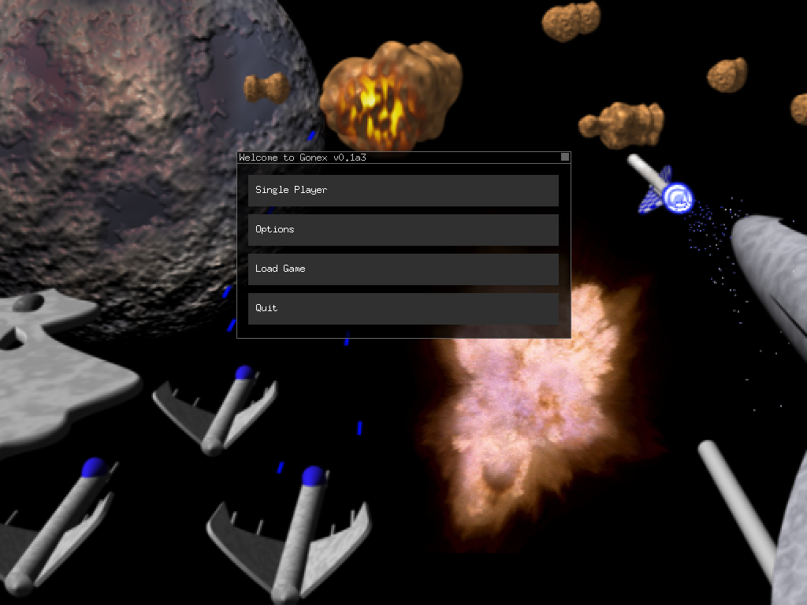

*Picture 1. The main menu, over konex's ships, planets and explosions.*

1. The window title carries the version, `Gonex v0.1a3`.
2. **Single Player** leads to the three games: **Team Deathmatch** (konex's three-way war),
   **Sunday Drive** (no opposition, for flying) and **Trader** (the campaign, which starts on 8,000
   credits of margin).
3. **Options** has Display (FPS, HUD, mini-map, target) and Player (name, ship). **Load Game** reads
   `save.json`.

## 2. The Yodacon '97: a ship recovered from 1997

**Why it exists.** The game has twelve ships from konex. The thirteenth is the **Yodacon** exactly
as it shipped in 1997: its sprites were decoded out of the ConEx plugin's resource fork (PICT 20617
and mask 20618), along with its target, shipyard and comm pictures.

**How it fits.** It is ship 13 in the shipyard. Its 350 tonnes are the same 350 tonnes the reentry
model was built around, and the Approach School's last lesson ("Doctrine: The Freighter") is flown
in it. The other 1997 hulls (the pins, Dart, Defender, Gryphon, Trident, Necromancer, Tomaquad) were
recovered the same way.

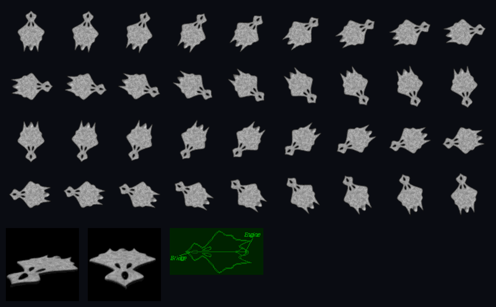

*Picture 2. The Yodacon '97 as the game loads it, from `assets/data/ships/yodacon97/`. Drawn for
this guide by `scripts/feature-sheets.go`, at twice size.*

1. The 36 rotations, 10 degrees apart, each 70 × 70 pixels.
2. The shipyard picture and the comm picture.
3. The target picture, the 1997 green line drawing with "Bridge" and "Engine" called out.

Its specs (`specs.xml`): max velocity 600, turn 90, acceleration 560, mass 350, collision radius
35. The extraction tools (`rsrc_extract.py`, `pict_decode.py`) live in the yodacon repo.

**Check yourself.**

- Which ship number is the Yodacon '97? (13.)
- Where did its pictures come from? (The ConEx plugin's resource fork, not a redraw.)

## 3. Team deathmatch: konex's war

**Why it exists.** This is the game konex was: top-down team-deathmatch space combat, three
teams, missiles, health and money drops, respawns at the team spawn points. Gonex keeps its numbers:
collision range 64, missile speed 2000 with a 2-second life, fire cooldown 0.2 s, health recharge
1 hp every 3 s, items that last 15 s and drop one time in five.

**How it fits.** The war is the background of every other mode. The trader game is played in the
same three-colour world, so the lanes are armed and the chart shows a way out of the fight.

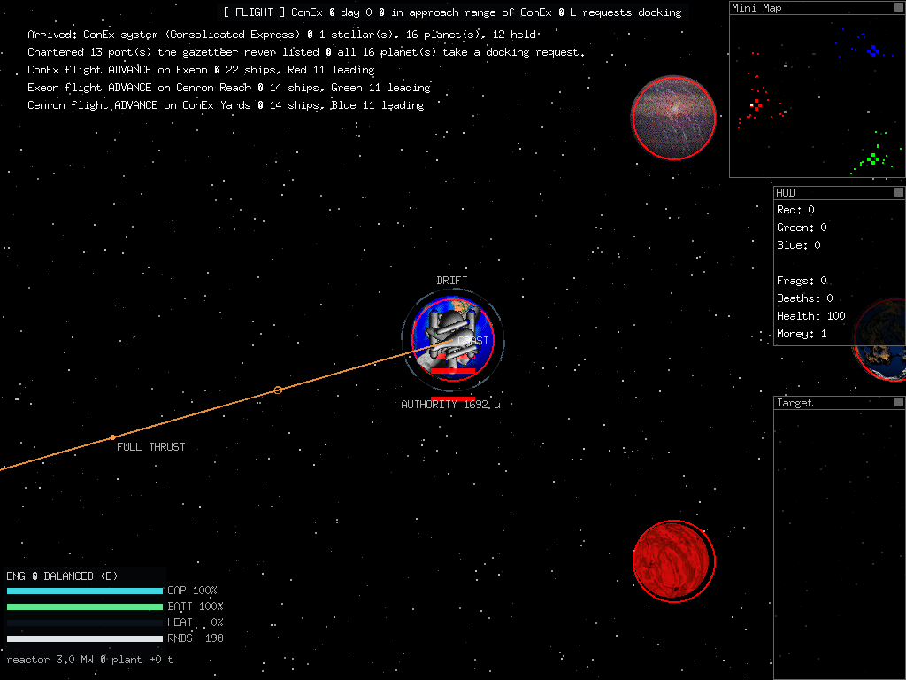

*Picture 3. Team deathmatch: the player's ship, flights of all three colours, and the HUD
windows.*

1. The banner: mode, system, day, and the docking hint when a planet is in range.
2. The notify feed. Each colour's flights report their phase ("ADVANCE on Exeon").
3. The mini map: red, green and blue squadrons.
4. The HUD: each team's score, then the player's frags, deaths, health and money.
5. The target window, empty until Left Shift picks the nearest enemy.

The scene (`assets/deathmatch.xml`) gives each colour twenty-four pilots: ten hold the capital,
twelve are raised against a named enemy colour, and two run the deck. Each has its own
jittered ranges and bingo number, and a pilot off the pad musters into a flight before setting
out. Controls are konex's: arrows
turn and thrust, Space fires, X brakes, Left Shift targets, Left Ctrl toggles autotarget, Tab shows
the full map.

**The developer console.** Backquote drops konex's 270-pixel console: `god`, `spawn`, `stat`,
`listships`, `team N`, `playership N`, `savegame`, `loadgame` and the rest are listed in the
README. It is not pictured here.

## 4. Flight: the HUD, the grid and the approach

**Why it exists.** Before any landing there is the top-down view: find a planet, line up, ask for
clearance. Gonex adds the power grid, because every mode spends the same capacitors and battery.

**How it fits.** The grid panel at the bottom left is the machine the whole game shares: combat
spends the capacitors, cruise refills them, entry drains the deep store with the radiators blind,
and the outfitter sells the upgrades. `E` cycles its allocation presets.

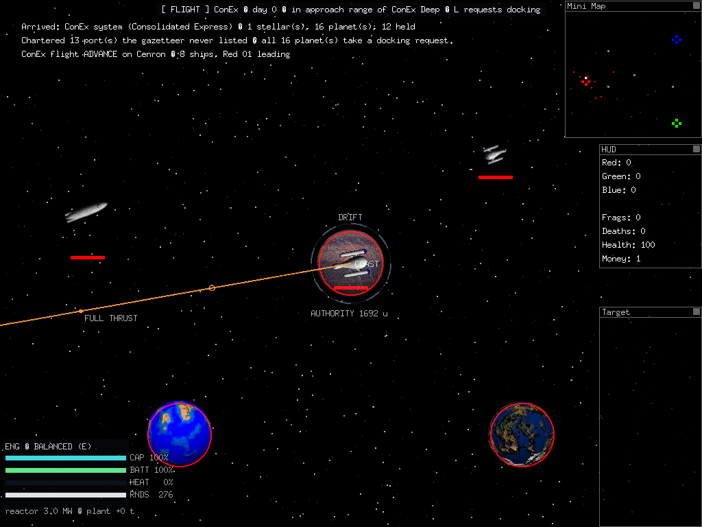

*Picture 4. Flight. The planet under the ship is in approach range.*

1. The banner says it: "in approach range of ConEx Deep · L requests docking".
2. The orange line is the docking approach vector, with its FULL THRUST mark; DRIFT, COAST and
   AUTHORITY read the approach.
3. The power grid: preset (BALANCED), capacitors, battery, heat, rounds, reactor output.
4. The mini map, HUD and target panels are draggable windows, as in konex.

To travel, `M` opens the chart (click a system to plot a course), you fly to the warp beacon
marker, and `J` jumps. Every jump costs three days and 100 fuel.

## 5. Docking and the deorbit burn

**Why it exists.** In Gonex, landing is never a keypress; it is a descent you fly. The handshake
makes it a decision instead of a reflex.

**How it fits.** It is the door between the two games: the top-down war above, the reentry trader
below.

1. **Approach.** Fly within range of a planet.
2. **Handshake.** `L` hails control. After a beat you are assigned a pad and cleared, with a
   30-second clearance window.
3. **Commit.** `L` again commits the deorbit burn.

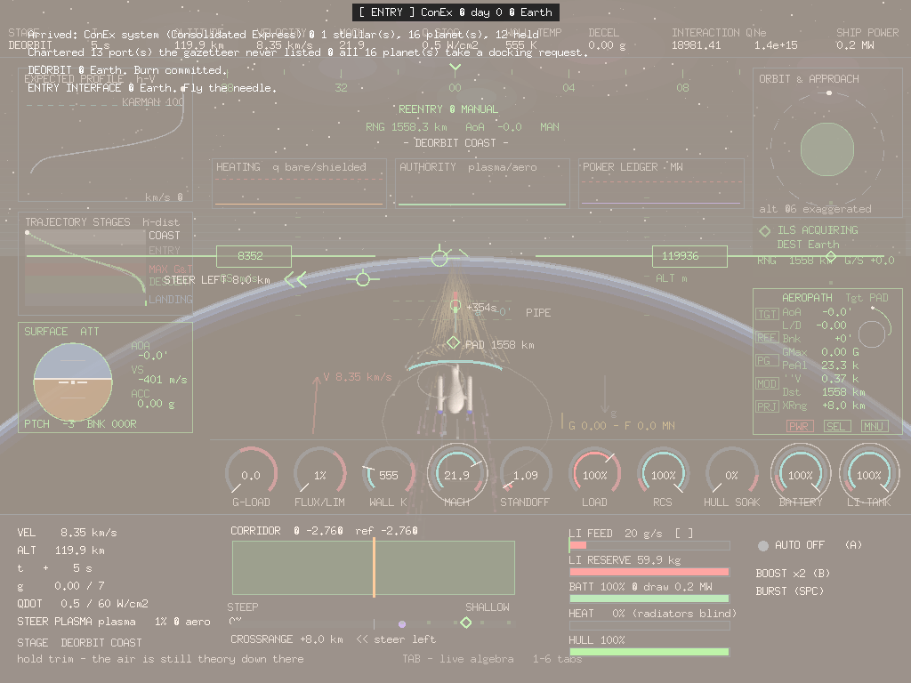

*Picture 5. Deorbit coast at 119.9 km: the first plasma washes the screen white.*

1. The stage readout: DEORBIT COAST, 5 s in.
2. The feed: "DEORBIT · Earth. Burn committed." then "ENTRY INTERFACE · Earth. Fly the needle."
3. The planet limb, and the pad 1,558 km downrange.

## 6. Reentry: flying the needle

**Why it exists.** A 350-tonne freighter has an anvil's ballistic coefficient. The game's answer
is the **magnetohydrodynamic deflector cone**: the nose coil makes the hull a dipole, the bow wave
ionizes, and the plasma is deflected around the ship instead of into it. Lithium seed keeps the
shock layer lit. Steering is done by tilting the dipole, then, as the air thickens and the plasma
dies, by aerodynamic surfaces. The Pilot's Guide explains each piece. It is a game: nothing in
it is validated engineering.

**How it fits.** This is where cargo and outfits cost something. Every tonne bought at the
outfitter raises the ballistic coefficient, and the hull, clamp and computer damage taken here is
paid for in the yard.

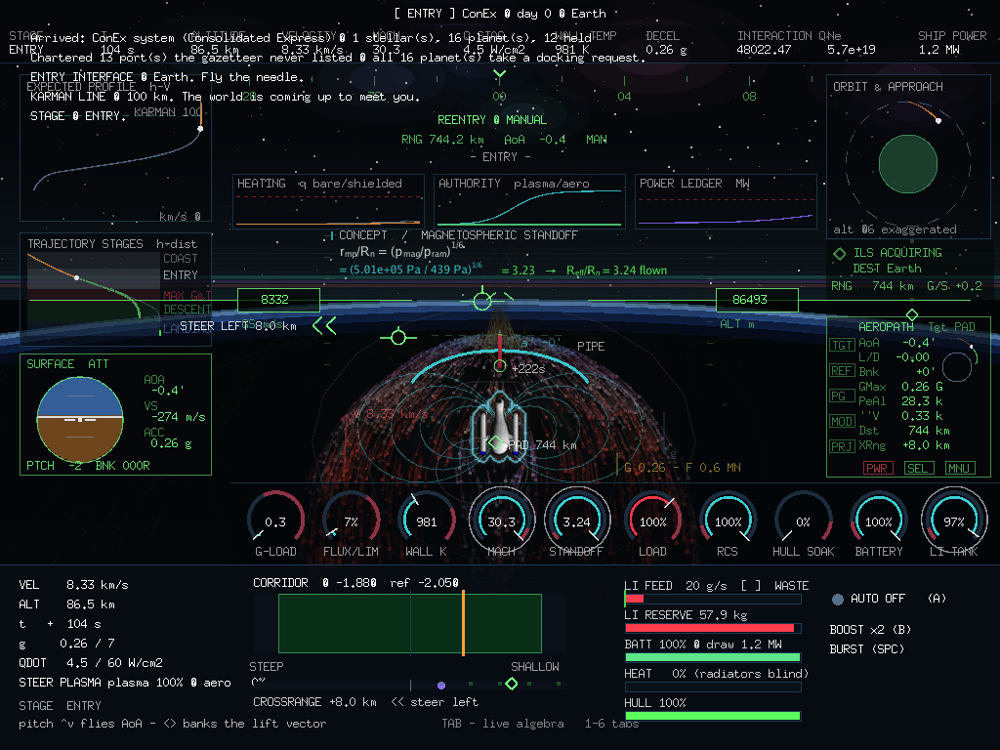

*Picture 6. Reentry, hand-flown, at 86.5 km and Mach 30.*

1. The dipole field lines and the plasma sheath around the hull: the cone.
2. The corridor gauge: steep burns, shallow skips out, and the caret is the line the debrief pays
   on.
3. The dial cluster: G-load, flux against limit, wall temperature, Mach, standoff, load, RCS, hull
   soak, battery, lithium tank.
4. The concept card: the magnetospheric standoff equation, with this moment's numbers.
5. ORBIT & APPROACH: the parking orbit and the descent, altitudes exaggerated.

Touch down inside 2 km of the pad line for the full pad bonus, inside 10 km for half. Hull to
100% in the plasma, or reaching the deck too hot, ends in the **DED** screen; any key resumes from
the last berth save. (Not pictured.)

**Check yourself.**

- What keeps the shock layer ionized when the air alone would recombine? (Lithium seed, `[` and
  `]`.)
- What does the console say when aero authority passes plasma? ("We're in the pipe, five by
  five.")

## 7. Autoland and the instruments

**Why it exists.** The corridor is hard. Autoland (`A`) lets a player watch it flown well before
flying it.

**How it fits.** The same instruments read the same flow state either way.

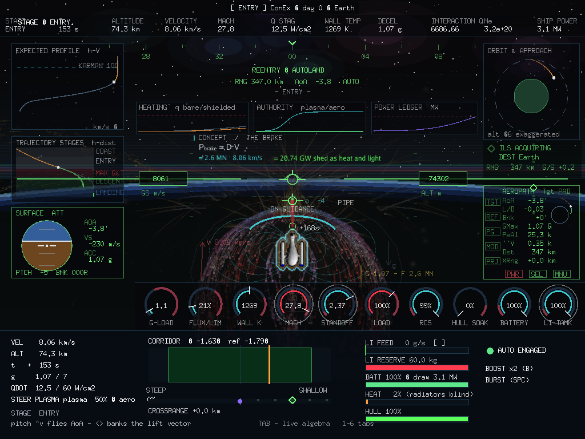

*Picture 7. The same corridor at 74.3 km, autoland engaged.*

1. REENTRY · AUTOLAND, ON GUIDANCE.
2. The concept card has moved on to "THE BRAKE": 2.6 MN × 8.06 km/s = 20.74 GW shed as heat and
   light.
3. The strip charts: heating bare and shielded, authority plasma and aero, the power ledger.
4. STEER PLASMA plasma 50% · aero: the handoff in progress.

The landing camera spans five orders of magnitude, from the 122 km interface to the 2 km pad line,
by fading in tiers: the planet limb, shore patterns, city lights, terrain, then the pad.

## 8. The concourse

**Why it exists.** A landing should end somewhere. The concourse is the hub of the trader game:
every shop is one key away.

**How it fits.** Every touchdown writes the berth save automatically, and costs a day.

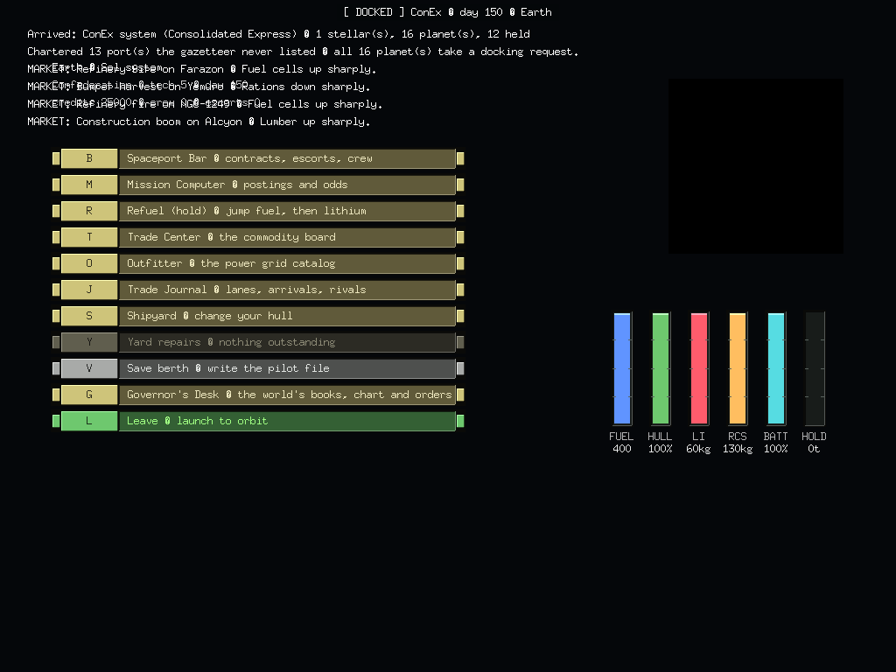

*Picture 8. The concourse, docked at Earth on day 150.*

1. The keys: B bar, M missions, R refuel, T trade, O outfitter, J journal, S shipyard, Y repairs,
   V save berth, G Governor's Desk, L leave.
2. The ship's gauges: fuel, hull, lithium, RCS, battery, hold.
3. The black box at the top right is where a port's 1997 landing view goes; Earth has none.

An honest note: the `MARKET:` lines at the top draw over each other on every docked screen. The
flight manual lists this as a known bug.

## 9. The 1997 landing views

**Why it exists.** ConEx's ports had their own landing pictures. Gonex shows them behind the dock
screen at the ports that had one.

**How it fits.** They are the same recovered art as the Yodacon: decoded from the plugin, not
redrawn.

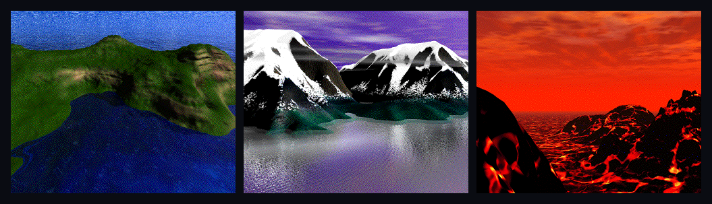

*Picture 9. The three ConEx landing views, from `assets/data/conex/land/`. Laid side by side for
this guide by `scripts/feature-sheets.go`.*

1. ConEx (13514).
2. Exeon (13515).
3. Cenron (13516).

## 10. The bar and the mission computer

**Why it exists.** ConEx's missions were the 1997 plugin's story. Gonex runs them on the original
mission machine: 512 control bits and the original mission records, GIVEN/SETS clauses intact.

**How it fits.** Missions are what send you through the corridor. The bar is who walked in today;
the computer is the whole board.

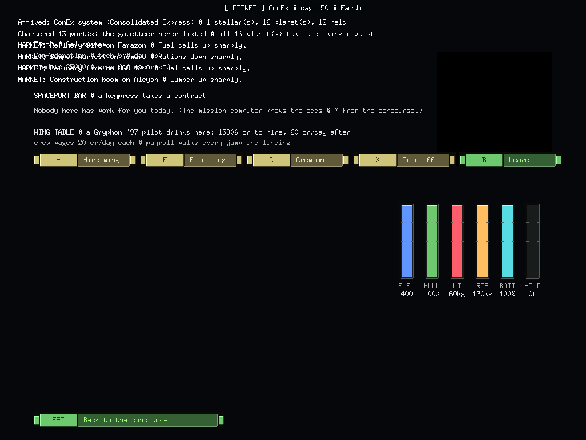

*Picture 10. The spaceport bar.*

1. "Nobody here has work for you today": once per landing, each eligible posting rolls a d100
   against its daily chance.
2. The wing table: a Gryphon '97 pilot for hire, with a daily wage. Escorts (H, F) and crew (C, X)
   are hired here.

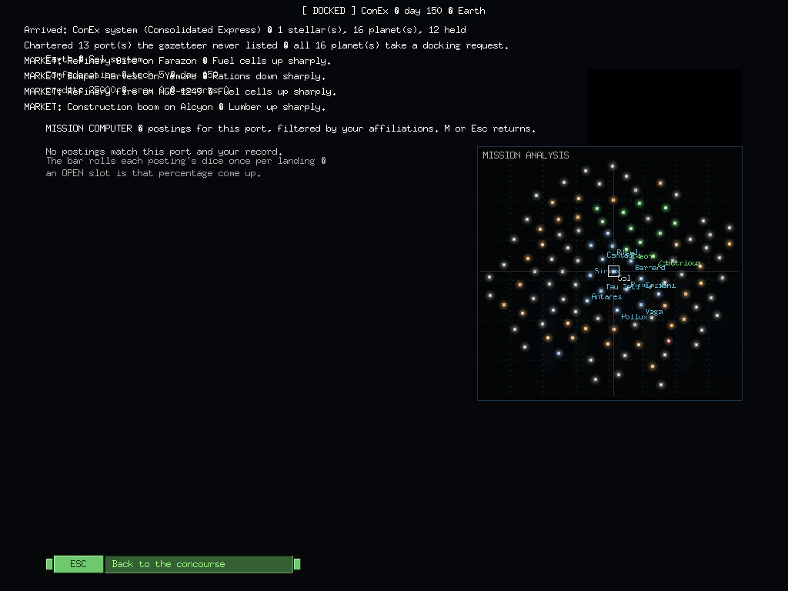

*Picture 11. The mission computer, filtered by this port and your affiliations.*

1. No postings match this port and record, on this save.
2. The mission analysis chart.

The **Approach School** (missions 300–309) forks the original ConEx flight-school chain at bit 126,
after Trading 202 and instead of combat training: ten lessons in landing and heat discipline, from
"The Corridor" to "Rags to Riches". See [FLIGHT-SCHOOL.md](FLIGHT-SCHOOL.md).

## 11. Trade, outfitting and the shipyard

**Why it exists.** Credits buy hulls, escorts and a power grid; the atmosphere charges for every
tonne of it on the way back down. These three screens are where that trade-off is made.

**How it fits.** Cargo and outfits add mass; mass makes the corridor hotter; damage costs credits.

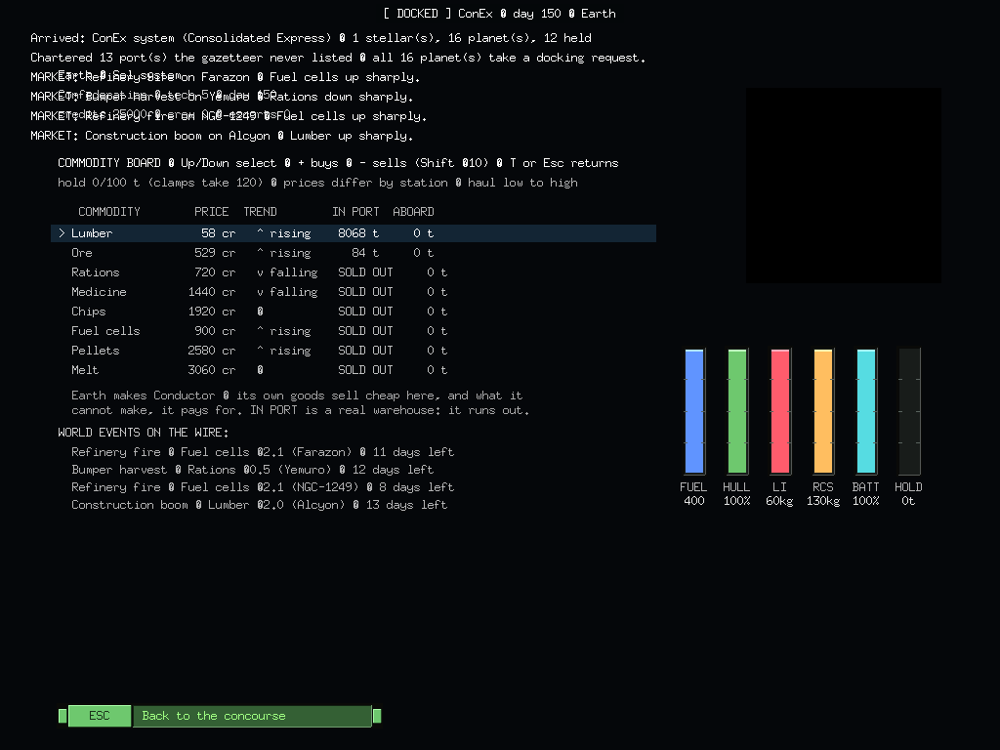

*Picture 12. The commodity board at Earth.*

1. Eight goods with price, trend, what is in port and what is aboard. IN PORT is a real warehouse,
   and it runs out: six of eight are SOLD OUT here.
2. World events on the wire, each moving one price for a number of days.

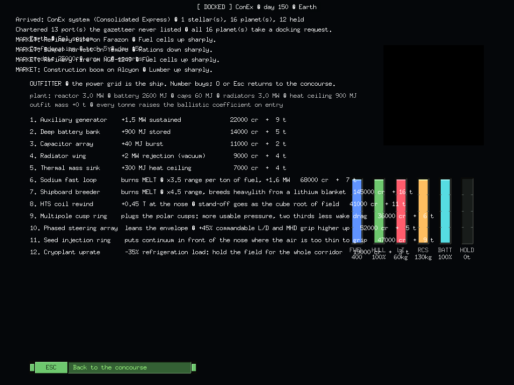

*Picture 13. The outfitter: twelve items, each with its mass.*

1. The plant line: reactor, battery, capacitors, radiators, heat ceiling.
2. "Every tonne raises the ballistic coefficient on entry."
3. Items 1–5 are power-grid upgrades, 6–7 reactors, 8–12 plasma-confinement upgrades.

An honest note: the long rows run under the gauges. The flight manual lists this too.

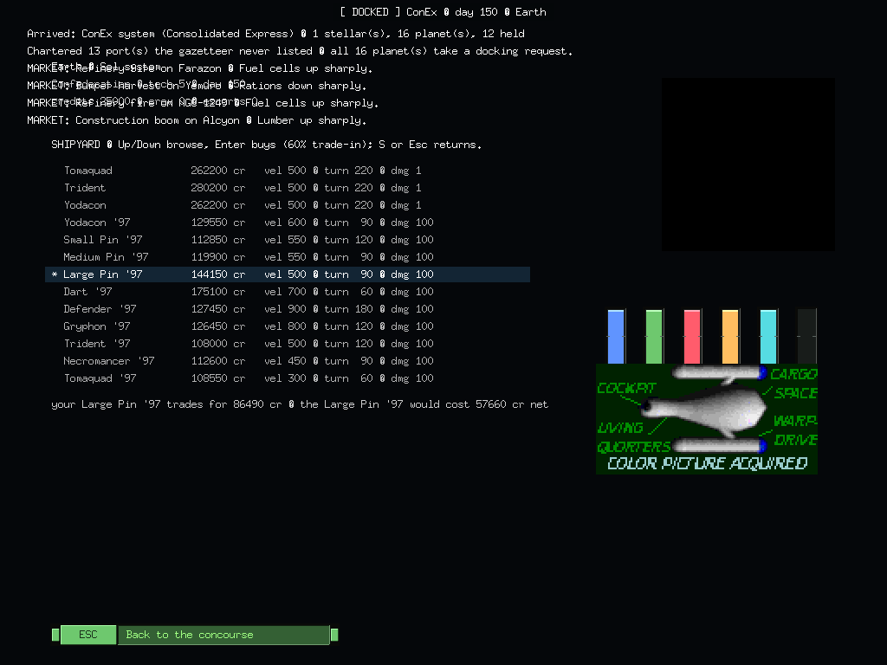

*Picture 14. The shipyard: konex's hulls and the 1997 ones.*

1. Each hull's price, velocity, turn and damage; Yodacon '97 is in the list.
2. The trade-in line: Enter buys at 60%.
3. The selected hull's 1997 shipyard picture.

## 12. The journal and the Governor's Desk

**Why it exists.** The colours don't only fight: they haul, build and tax. The journal shows that
economy as it runs; the Governor's Desk opens a world's books.

**How it fits.** The trader buys and sells inside the same economy the AI hulls are running.

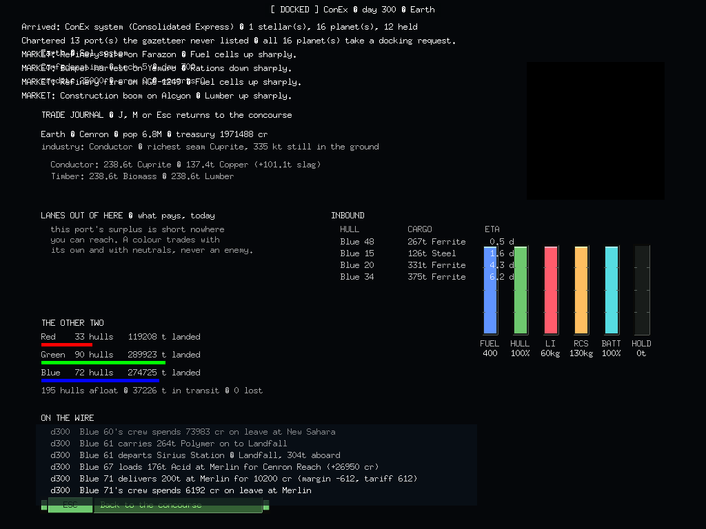

*Picture 15. The trade journal on day 300.*

1. This world's industry and its richest seam.
2. Inbound hulls with cargo and ETA.
3. The three colours: hulls and tonnage landed.
4. On the wire: every load, delivery, tariff and shore leave.

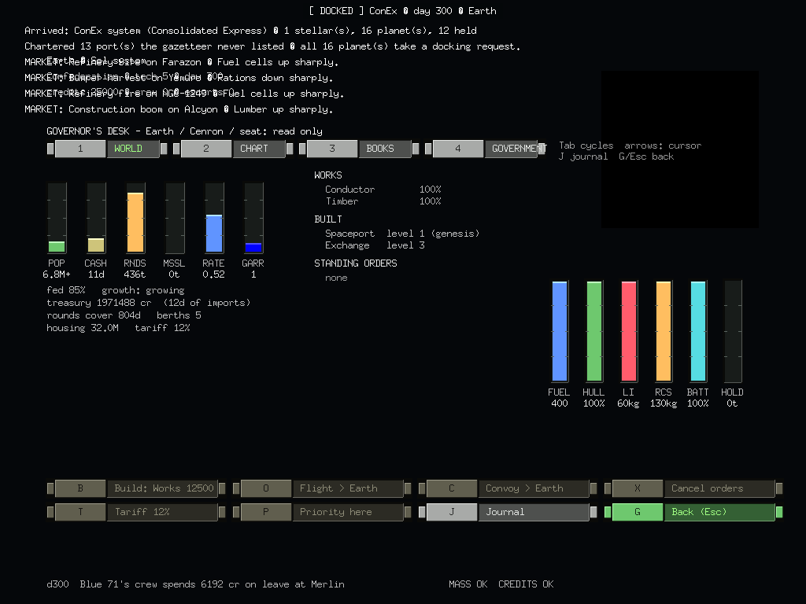

*Picture 16. The Governor's Desk (`G`), tab 1 of 4: WORLD.*

1. The tabs: WORLD, CHART, BOOKS, GOVERNMENT.
2. Population, cash, rounds, missiles, defence rating and garrison.
3. "MASS OK CREDITS OK": the audit line that checks both are conserved.

## 13. Takeoff: the landing, backwards

**Why it exists.** Leaving should be flown too, but quickly: twelve seconds against the entry's
hundred.

**How it fits.** It closes the loop: `L` on the pad, back into orbit on the flight map, escorts on
the wing, and on to the next port.

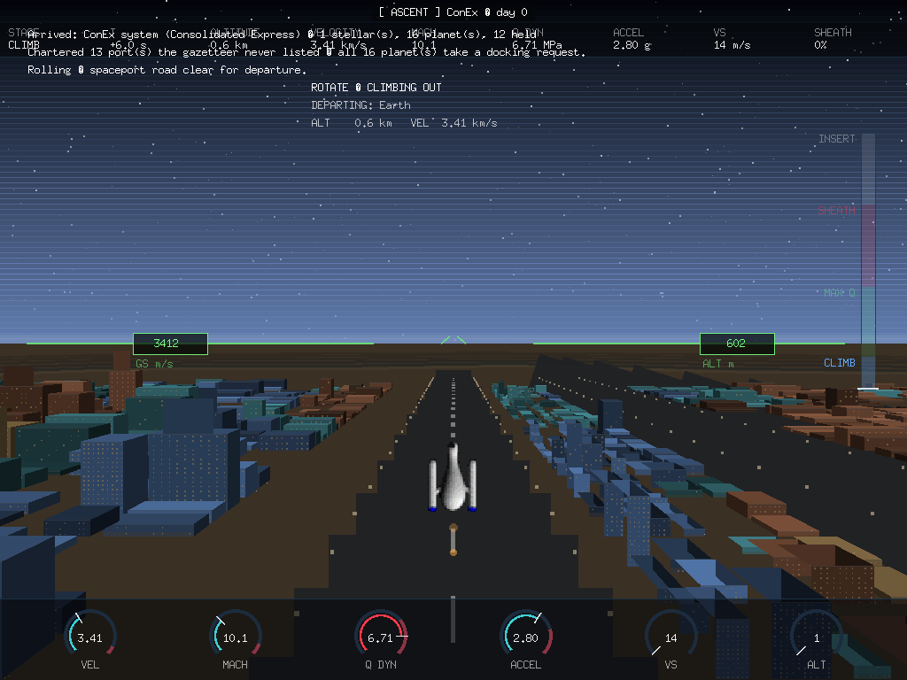

*Picture 17. The climb out at 0.6 km.*

1. The spaceport road, laid like a runway, with the town all on one side of it. The town grows
   from the port's seed, so it is the same town every time.
2. ROTATE · CLIMBING OUT.
3. The ascent bar: CLIMB, MAX Q, SHEATH, INSERT.
4. The ascent gauges: velocity, Mach, dynamic pressure, acceleration, vertical speed, altitude.

## 14. How it fits together

| Feature | Where from | Why it exists | Feeds |
| --- | --- | --- | --- |
| Menu, console, window UI | konex (2005) | to pick a game and inspect it | every mode |
| Team deathmatch | konex (2005) | the original game, its numbers kept | the armed lanes the trader flies |
| Yodacon '97 and the 1997 hulls | ConEx (1997), decoded | the plugin's own ships, flying again | shipyard, Approach School |
| Power grid | Gonex | one machine every mode spends | flight, entry, outfitter |
| Chart, beacons, jumps | Gonex | travel costs time and fuel | missions, trade |
| Docking handshake, deorbit | Gonex | landing is a decision | reentry |
| Reentry corridor, autoland | Gonex | the cost of mass, felt in the hands | damage, pad bonus, DED |
| Concourse and landing views | Gonex; 1997 art | a place to arrive | every shop, the berth save |
| Bar, mission computer | ConEx's missions on Gonex | the 1997 story, still running | where you fly next |
| Approach School | Gonex | teaches the corridor, ship by ship | the mission chain |
| Trade, outfitter, shipyard | Gonex | what you carry, at what weight | the next entry |
| Journal, Governor's Desk | Gonex | the economy, made visible | prices, the war |
| Takeoff | Gonex | the loop closes | flight |

**Deviations from konex** (from the README): a fixed 60 Hz timestep; a portable bitmap font; save
and load as a real JSON snapshot; networking and sound omitted, as they were already stubbed out
upstream.

## Taking the pictures again

- Pictures 2 and 9: `go run scripts/feature-sheets.go`, from the repo root.
- The screenshots: the game's own hooks, on a machine with a display. `GONEX_BOOT` drops straight
  into a screen (`war`, `flight`, `entry 133 auto`, `dock 133 bar`, `takeoff 133`, and so on; see
  `internal/app/app.go`), `GONEX_CMD` runs console commands at boot, and `GONEX_SHOT=file.png`
  with `GONEX_SHOT_FRAME=N` writes frame N to a PNG.
